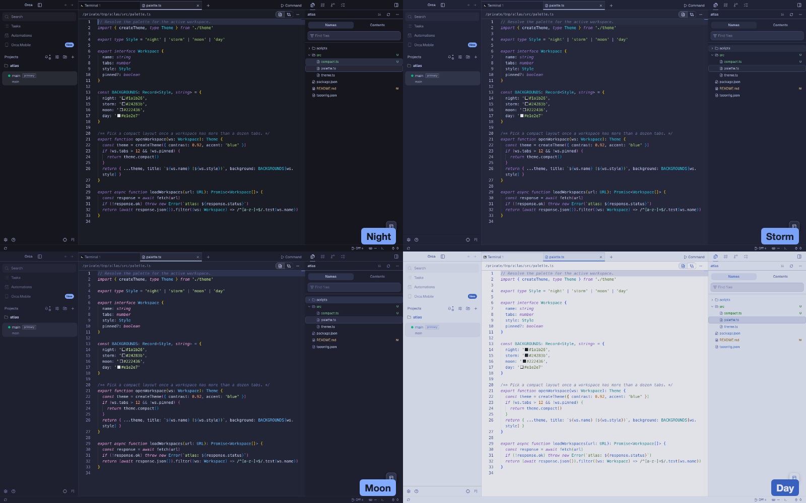

# Tokyo Night for Orca

[Tokyo Night](https://github.com/folke/tokyonight.nvim) app, editor and terminal themes for
[Orca](https://github.com/stablyai/orca), in all four styles: Night, Storm, Moon and Day.
This is an unofficial port, built from tokyonight.nvim commit
[`cdc07ac`](https://github.com/folke/tokyonight.nvim/commit/cdc07ac78467a233fd62c493de29a17e0cf2b2b6)
(28 commits after v4.14.1).



## Styles

Each style themes the app, the editor's syntax colors and the terminal's 16 ANSI colors.
Blue is the accent everywhere. Night, Storm and Moon are dark themes. Day is a light theme.

### Night

| Editor | Terminal |
| --- | --- |
|  |  |

### Storm

| Editor | Terminal |
| --- | --- |
|  |  |

### Moon

| Editor | Terminal |
| --- | --- |
|  |  |

### Day

| Editor | Terminal |
| --- | --- |
|  |  |

## Install

Find **Tokyo Night for Orca** in Orca's plugin directory and install it. To install it from this
repository instead:

1. In Orca, open Settings → Plugins.
2. Open **Add plugin** → **From a Git URL…**.
3. Enter `https://github.com/vale-c/orca-tokyonight.git` with ref `main`, and install
   **Tokyo Night for Orca**.
4. In Settings → Appearance, pick a Tokyo Night style as the dark theme and Tokyo Night Day as the
   light theme. Pick the matching Tokyo Night terminal themes in the terminal settings.

To try a local copy instead, use **Add plugin** → **From a folder…** and select the
root folder of this repository. Orca reloads the themes when the files change.

## Differences from upstream

Every color comes from the computed palettes in tokyonight.nvim's `extras/lua`, with the default
options (dark sidebars and floats, italic comments and keywords). Each Orca token and syntax scope
uses the color that tokyonight.nvim gives the matching highlight group. `scripts/build.mjs` names
the group next to each mapping.

Orca drops a syntax color under 3:1 contrast with the editor background, so these syntax colors
are changed in OKLCH lightness only, keeping chroma and hue:

| Style | Color | Used for | Upstream | Shipped |
| --- | --- | --- | --- | --- |
| Night | `comment` | Comments | `#565f89` | `#5c6690` |
| Night | `git.delete` | Deleted lines | `#914c54` | `#9a545c` |
| Storm | `comment` | Comments | `#565f89` | `#67719c` |
| Storm | `git.delete` | Deleted lines | `#914c54` | `#a65e66` |
| Moon | `error` | Invalid code | `#c53b53` | `#c73d54` |
| Day | `comment` | Comments | `#848cb5` | `#767ea6` |
| Day | `red` | Builtin variables, JSX tags | `#f52a65` | `#f32764` |
| Day | `git.add` | Inserted lines | `#4197a4` | `#348b98` |
| Day | `git.delete` | Deleted lines | `#c47981` | `#b56b73` |

Orca drops an app text color under 4.5:1 contrast with its surface. Day's `fg` is 4.52:1 on `bg`,
so it is under 4.5:1 on every darker Day surface. Day changes these colors:

| Orca tokens | Upstream | Shipped | Why |
| --- | --- | --- | --- |
| Card, popover, secondary and accent text | `fg` `#3760bf` | `#274eab` | Darkened in OKLCH lightness to 4.5:1 on `bg_highlight` |
| Muted and sidebar text | `fg_sidebar` `#6172b0` | `#495994` | Darkened in OKLCH lightness to 4.5:1 on `bg_dark` |
| Primary, sidebar primary and rings | `blue` `#2e7de9` | `fg` `#3760bf` | No palette color reads at 4.5:1 on `blue`. Day's `fg` is also a blue |
| Primary text | `black` `#b4b5b9` | `bg` `#e1e2e7` | Upstream's `black` is light gray in Day |

Day's editor text keeps upstream `fg`. Night, Storm and Moon use the upstream palette unchanged
for app colors.

Other differences, in every style:

- Borders and input outlines use `fg_gutter`, the color of upstream's indent guides and line
  numbers. Upstream's `border` is 1.05:1 on Night's `bg`, so card and input edges would not show.
  The sidebar edge keeps `border`, like upstream's window separator.
- Orca colors line numbers with the muted text color, `fg_sidebar`. Upstream uses the dimmer
  `fg_gutter`, which is under Orca's 4.5:1 floor for text.
- Orca derives the editor selection from the ring color, so it is `blue` at 30% opacity instead
  of upstream's `bg_visual`.
- Orca's built-in languages report one `keyword` token for every keyword, so in TypeScript every
  keyword is purple and italic. Plugin grammars with TextMate scopes also get upstream's magenta
  control flow, cyan imports and magenta `function` keyword.

Terminal colors are upstream's `extras/ghostty` files, verbatim. The cursor text color, which
those files do not set, is `bg`, as in upstream's `Cursor` group.

## Build and verify

The theme files in `themes` and `terminal` are generated.
Do not edit them by hand. Change `scripts/build.mjs` and rebuild instead.

```sh
node scripts/build.mjs           # regenerate the theme files from scripts/tokyonight-palette.json
node scripts/build.mjs --check   # exit 1 if a committed file is out of date
```

The build fails when an app token pair is under Orca's contrast floor. It prints every color it
adjusted in OKLCH lightness.

`scripts/tokyonight-palette.json` is copied from a tokyonight.nvim checkout. To move to a newer
upstream commit, run `node scripts/vendor-palette.mjs /path/to/tokyonight.nvim`, then rebuild.

To check the themes with Orca's own runtime code, point `ORCA_DIR` at an Orca checkout with its
dependencies installed:

```sh
ORCA_DIR=/path/to/orca node scripts/verify.mjs
cd /path/to/orca && node config/scripts/validate-plugin-files.mjs /path/to/orca-tokyonight
```

`verify.mjs` fails when Orca would drop a theme token or a syntax color, or reject a terminal theme.

`scripts/orca-e2e/tokyonight-theme.spec.ts` drives a real Orca build. It loads the plugin,
selects each style, and checks the applied app tokens and editor token colors.
It opens a small demo project, `atlas`, created under `TOKYONIGHT_DEMO_DIR` and deleted afterwards,
and saves an editor and a terminal screenshot per style. The cover and `docs/screenshots` are made
from them. Copy it into the Orca checkout's `tests/e2e/` and run:

```sh
TOKYONIGHT_PLUGIN_DIR=/path/to/orca-tokyonight TOKYONIGHT_SHOTS_DIR=/tmp/shots TOKYONIGHT_DEMO_DIR=/tmp \
  npx playwright test tests/e2e/tokyonight-theme.spec.ts --config tests/playwright.config.ts --project=electron-headless
```

## Release

Orca's plugin directory lists the newest `vX.Y.Z` tag. To release a change:

1. Bump `version` in `orca-plugin.json` and commit.
2. Run the Orca validator on this folder. It prints the release entry for that commit.
3. Paste that entry first in `releases` in `orca-catalog.json`, and commit.
4. Validate the catalog with
   `node config/scripts/validate-plugin-files.mjs /path/to/orca-tokyonight/orca-catalog.json`.
5. Commit, then push the tag: `git tag v1.0.0 && git push origin main v1.0.0`.

`orca-catalog.json` is what **From a Git URL…** reads.

## License

MIT. See [LICENSE](LICENSE), which also includes tokyonight.nvim's Apache License 2.0.
