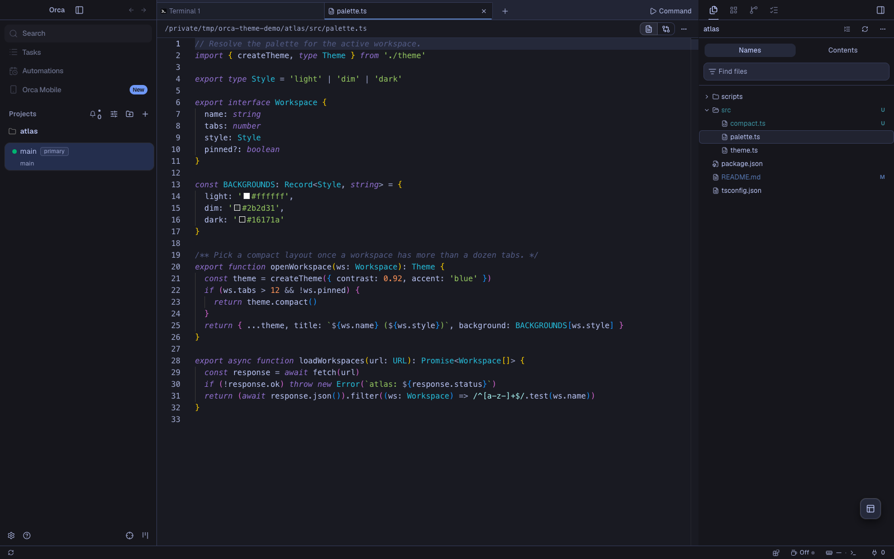
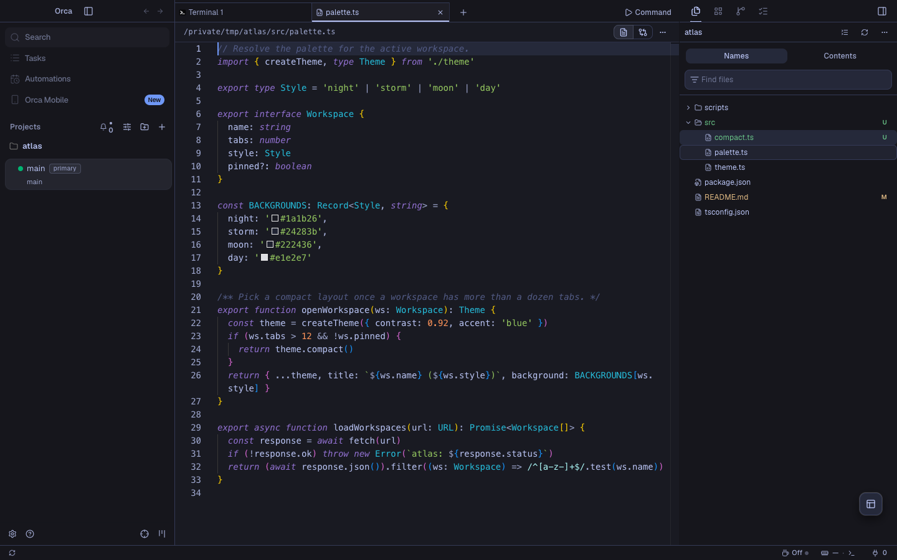
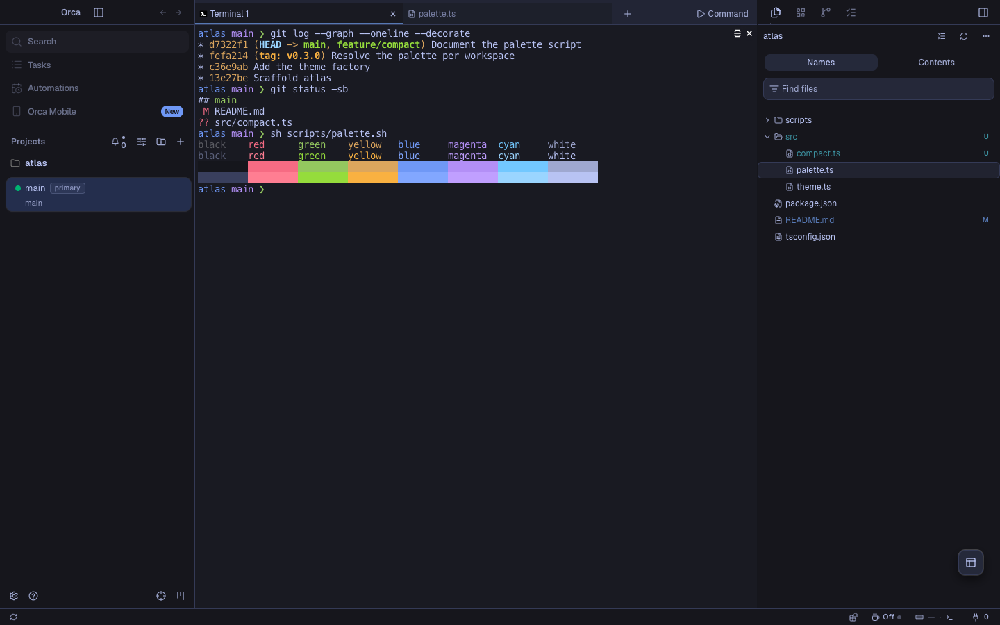
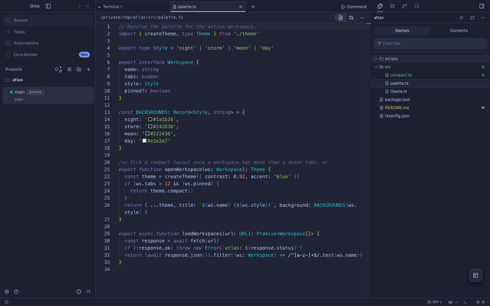
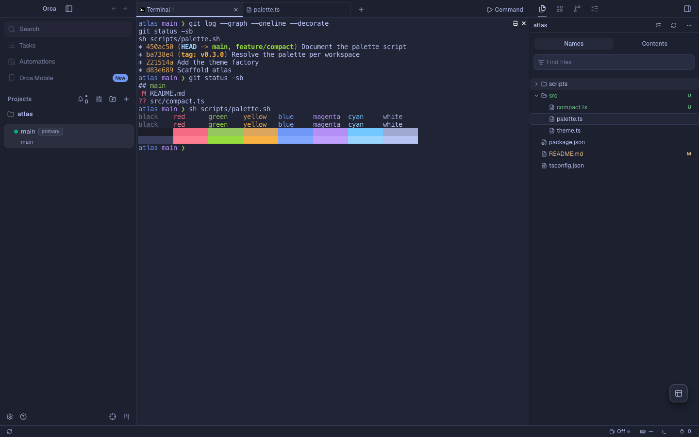
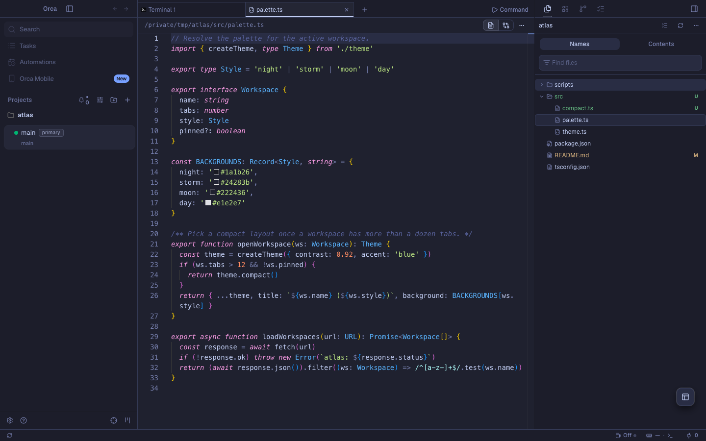
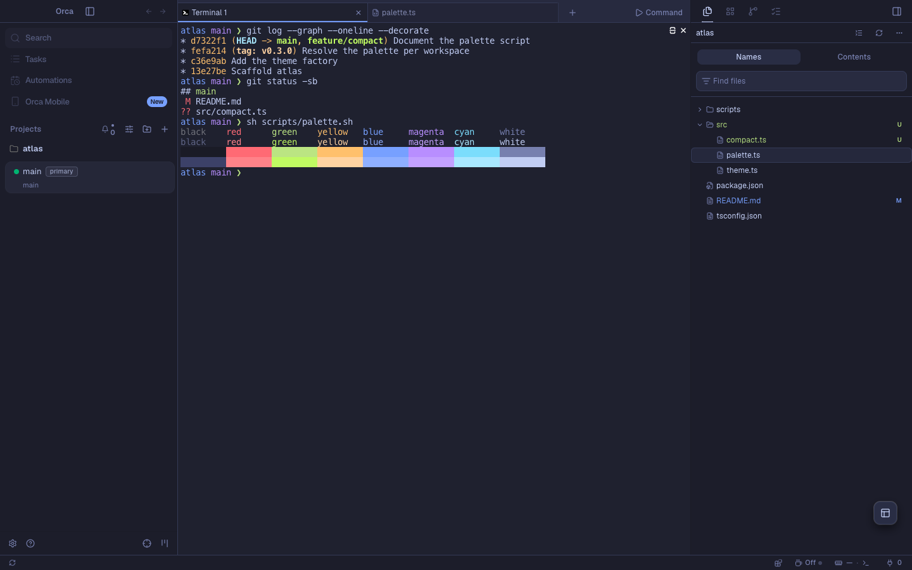
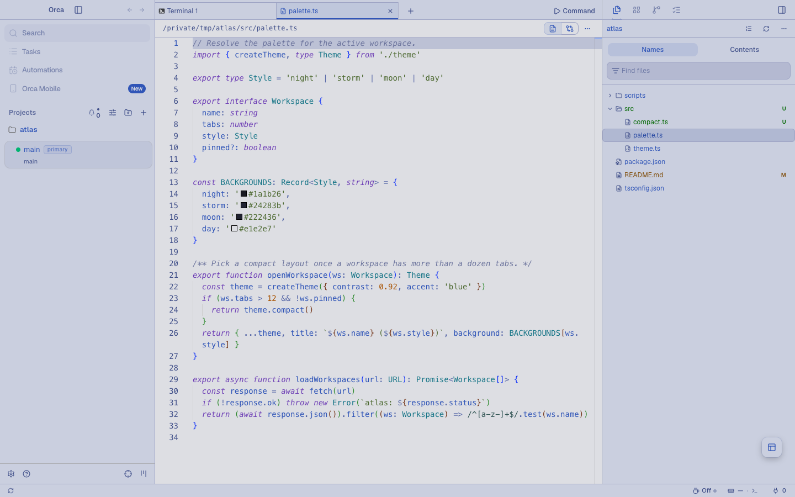
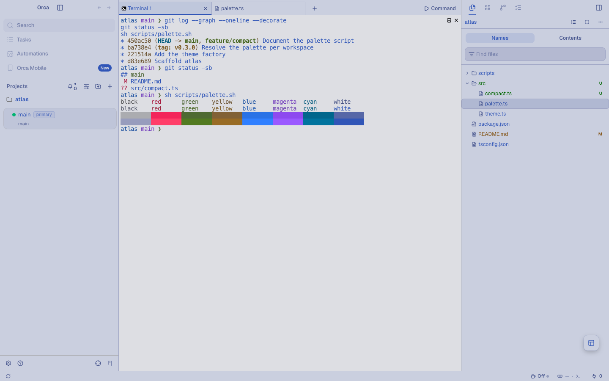

# Tokyo Night for Orca

[Tokyo Night](https://github.com/folke/tokyonight.nvim) app, editor and terminal themes for
[Orca](https://github.com/stablyai/orca), in all four styles: Night, Storm, Moon and Day.
This is an unofficial port, built from tokyonight.nvim commit
[`cdc07ac`](https://github.com/folke/tokyonight.nvim/commit/cdc07ac78467a233fd62c493de29a17e0cf2b2b6)
(28 commits after v4.14.1).

Orca's official [Tokyo Night plugin](https://github.com/stablyai/orca-plugins/tree/main/plugins/tokyo-night-theme)
ports the VS Code theme's Night, Storm and Light. This plugin is built from tokyonight.nvim instead,
adds the Moon and Day styles, and also colors diffs, git status, tabs and links.



## Styles

Each style themes the app, the editor's syntax colors and the terminal's 16 ANSI colors.
Blue is the accent everywhere. Night, Storm and Moon are dark themes. Day is a light theme.

### Night

| Editor | Terminal |
| --- | --- |
|  |  |

### Storm

| Editor | Terminal |
| --- | --- |
|  |  |

### Moon

| Editor | Terminal |
| --- | --- |
|  |  |

### Day

| Editor | Terminal |
| --- | --- |
|  |  |

## Install

Find **Tokyo Night for Orca** in Orca's plugin directory and install it. To install it from this
repository instead:

1. In Orca, open Settings → Plugins.
2. Open **Add plugin** → **From a Git URL…**.
3. Enter `https://github.com/vale-c/orca-tokyonight.git` with ref `main`, and install
   **Tokyo Night for Orca**.
4. In Settings → Appearance, pick a Tokyo Night style as the dark theme and Tokyo Night Day as the
   light theme. Pick the matching Tokyo Night terminal themes in the terminal settings.

To try a local copy instead, use **Add plugin** → **From a folder…** and select the
root folder of this repository. Orca reloads the themes when the files change.

## Differences from upstream

Every color comes from the computed palettes in tokyonight.nvim's `extras/lua` and the diff tints
in `extras/delta`, with the default options (dark sidebars and floats, italic comments and
keywords). Each Orca token and syntax scope uses the color that tokyonight.nvim gives the matching
highlight group. `scripts/build.mjs` names the group next to each mapping.

Diff, git status, tab and link colors come from the groups upstream gives those jobs: `DiffAdd`
and `DiffDelete` with the delta extra for diff lines and changed characters, gitsigns and
nvim-tree for git status, barbar and bufferline for tabs, `@markup.link` for links, and the pi
agent extra for your chat messages.

Orca drops a color under its contrast floor: app text under 4.5:1 on its surface, git status
colors under 3:1 on the sidebar, syntax colors under 3:1 on the editor background, and diff tints
under 4.5:1 with the text drawn on them. These colors are changed in OKLCH lightness only, keeping
chroma and hue. `scripts/deviations.json` lists them, and `scripts/verify.mjs` checks each one:

| Style | Orca token or syntax rule | Upstream color | Upstream | Shipped |
| --- | --- | --- | --- | --- |
| Night | `--tab-inactive-foreground` | `dark5 at 80% on bg` | `#616789` | `#8289ad` |
| Night | `--diff-added` | `git.add` | `#449dab` | `#49a2b0` |
| Night | `--diff-removed` | `git.delete` | `#914c54` | `#ba7178` |
| Night | `--git-decoration-deleted` | `git.delete` | `#914c54` | `#955058` |
| Night | `--git-decoration-ignored` | `git.ignore` | `#545c7e` | `#5b6385` |
| Night | Comments | `comment` | `#565f89` | `#5c6690` |
| Night | Deleted | `git.delete` | `#914c54` | `#9a545c` |
| Storm | `--tab-inactive-foreground` | `dark5 at 80% on bg` | `#636a8d` | `#8991b5` |
| Storm | `--diff-added` | `git.add` | `#449dab` | `#5eb6c4` |
| Storm | `--diff-added-emphasis` | `delta.add` | `#316172` | `#2c5c6d` |
| Storm | `--diff-removed` | `git.delete` | `#914c54` | `#cd8289` |
| Storm | `--git-decoration-deleted` | `git.delete` | `#914c54` | `#a05a61` |
| Storm | `--git-decoration-ignored` | `git.ignore` | `#545c7e` | `#646d90` |
| Storm | Comments | `comment` | `#565f89` | `#67719c` |
| Storm | Deleted | `git.delete` | `#914c54` | `#a65e66` |
| Moon | `--tab-inactive-foreground` | `dark5 at 80% on bg` | `#63698c` | `#8a91b6` |
| Moon | `--git-decoration-ignored` | `git.ignore` | `#545c7e` | `#626b8d` |
| Moon | Invalid | `error` | `#c53b53` | `#c73d54` |
| Day | `--card-foreground` | `fg` | `#3760bf` | `#274eab` |
| Day | `--popover-foreground` | `fg` | `#3760bf` | `#274eab` |
| Day | `--secondary-foreground` | `fg` | `#3760bf` | `#274eab` |
| Day | `--muted-foreground` | `fg_sidebar` | `#6172b0` | `#495994` |
| Day | `--accent-foreground` | `fg` | `#3760bf` | `#274eab` |
| Day | `--sidebar-foreground` | `fg_sidebar` | `#6172b0` | `#495994` |
| Day | `--sidebar-accent-foreground` | `fg` | `#3760bf` | `#274eab` |
| Day | `--tab-active-foreground` | `fg` | `#3760bf` | `#3058b7` |
| Day | `--tab-inactive-foreground` | `dark5 at 80% on bg` | `#8087a9` | `#565c7c` |
| Day | `--text-link` | `blue1` | `#188092` | `#006e80` |
| Day | `--diff-added-background` | `diff.add` | `#b7ced5` | `#d0e7ee` |
| Day | `--diff-added` | `git.add` | `#4197a4` | `#0b717d` |
| Day | `--diff-added-emphasis` | `delta.add` | `#95bec7` | `#c0ebf4` |
| Day | `--diff-removed-background` | `diff.delete` | `#dababe` | `#fcdbdf` |
| Day | `--diff-removed` | `git.delete` | `#c47981` | `#9d555e` |
| Day | `--diff-removed-emphasis` | `diff.delete` | `#dababe` | `#fcdbdf` |
| Day | `--git-decoration-added` | `git.add` | `#4197a4` | `#29828f` |
| Day | `--git-decoration-deleted` | `git.delete` | `#c47981` | `#ab626b` |
| Day | `--git-decoration-untracked` | `git.add` | `#4197a4` | `#29828f` |
| Day | `--git-decoration-copied` | `git.add` | `#4197a4` | `#29828f` |
| Day | `--git-decoration-ignored` | `git.ignore` | `#8990b3` | `#6f7597` |
| Day | Comments | `comment` | `#848cb5` | `#767ea6` |
| Day | Builtin variables | `red` | `#f52a65` | `#f32764` |
| Day | JSX tags | `red` | `#f52a65` | `#f32764` |
| Day | Inserted | `git.add` | `#4197a4` | `#348b98` |
| Day | Deleted | `git.delete` | `#c47981` | `#b56b73` |

Day's `fg` is 4.52:1 on `bg`, so it is under 4.5:1 on every darker Day surface. That is why Day
darkens most of its text colors and lightens its diff tints above `bg`. Day also changes these
roles:

| Orca tokens | Upstream | Shipped | Why |
| --- | --- | --- | --- |
| Primary, sidebar primary and rings | `blue` `#2e7de9` | `fg` `#3760bf` | No palette color reads at 4.5:1 on `blue`. Day's `fg` is also a blue |
| Primary text | `black` `#b4b5b9` | `bg` `#e1e2e7` | Upstream's `black` is light gray in Day |
| Links | `teal` | `blue1`, from `@markup.link.label` | Day's `teal` leaves the sRGB gamut before it reaches 4.5:1 on `bg` |
| Removed characters in diffs | delta's `minus-emph-style` | the removed-line tint | Delta's darker pink leaves the sRGB gamut before it gets lighter than `bg` |
| Your chat messages | `bg_dark` | Orca's own color | `fg` is under 4.5:1 on every Day fill darker than `bg` |

Day's editor text keeps upstream `fg`. In Night, Storm and Moon, only the colors in the first
table change.

Other differences, in every style:

- Borders, input outlines and split dividers use `fg_gutter`, the color of upstream's indent
  guides and line numbers. Upstream's `border` is 1.05:1 on Night's `bg`, so card and input edges
  and the line between split editors would not show. The sidebar edge keeps `border`, like
  upstream's window separator.
- Orca writes the chat's diff text as `--foreground` mixed 30% into the diff hue, so the diff hues
  (`git.add` and `git.delete`) change in lightness until that text reads on upstream's line tints.
  The line tints keep upstream's colors in Night, Storm and Moon.
- The current workspace row uses upstream's `bg_visual` in Night and Storm. In Moon and Day the
  sidebar text is under 4.5:1 on every upstream selection fill, so Orca's own row highlight is
  used.
- Orca colors line numbers with the muted text color, `fg_sidebar`. Upstream uses the dimmer
  `fg_gutter`, which is under Orca's 4.5:1 floor for text.
- Orca derives the editor selection from the ring color, so it is `blue` at 30% opacity instead
  of upstream's `bg_visual`.
- Orca's built-in languages report one `keyword` token for every keyword, so in TypeScript every
  keyword is purple and italic. Plugin grammars with TextMate scopes also get upstream's magenta
  control flow, cyan imports and magenta `function` keyword.

`scripts/derived-tokens.json` lists each Orca token this plugin leaves to Orca, and why.

Terminal colors are upstream's `extras/ghostty` files, verbatim. The cursor text color, which
those files do not set, is `bg`, as in upstream's `Cursor` group.

## Build and verify

The theme files in `themes` and `terminal` are generated.
Do not edit them by hand. Change `scripts/build.mjs` and rebuild instead.

```sh
node scripts/build.mjs           # regenerate the theme files from scripts/tokyonight-palette.json
node scripts/build.mjs --check   # exit 1 if a committed file is out of date
```

The build fails when an app token pair is under Orca's contrast floor. It writes every color it
changed in OKLCH lightness to `scripts/deviations.json`.

`scripts/tokyonight-palette.json` is copied from a tokyonight.nvim checkout. To move to a newer
upstream commit, run `node scripts/vendor-palette.mjs /path/to/tokyonight.nvim`, then rebuild.

To check the themes with Orca's own code, point `ORCA_DIR` at an Orca checkout after
`pnpm install` and `pnpm run build:packages`:

```sh
ORCA_DIR=/path/to/orca node scripts/verify.mjs
ORCA_DIR=/path/to/orca node scripts/coverage.mjs
cd /path/to/orca && pnpm validate:plugin /path/to/orca-tokyonight
```

- `verify.mjs` fails when Orca would drop a theme token or a syntax color, or reject a theme
  file. It prints `scripts/deviations.json` as a table and fails when a row changes more than
  lightness.
- `coverage.mjs` fails when a public Orca theme token is neither set by every style nor listed
  in `scripts/derived-tokens.json` with the reason Orca's own value is right.

`scripts/theme.spec.ts` drives a real Orca build. It loads the plugin, selects each style, checks
the painted app tokens and editor colors, and saves the cover and an editor and a terminal
screenshot per style. Copy it into the Orca checkout's `tests/e2e/` and run from there:

```sh
ORCA_THEME_PLUGIN_DIR=/path/to/orca-tokyonight ORCA_THEME_SHOTS_DIR=/tmp/tokyonight-shots \
  npx playwright test tests/e2e/theme.spec.ts --config tests/playwright.config.ts --project=electron-headless
```

## Release

Orca's plugin directory lists the newest `vX.Y.Z` tag. To release a change:

1. Bump `version` in `orca-plugin.json` and commit.
2. Run the Orca validator on this folder. It prints the release entry for that commit.
3. Paste that entry first in `releases` in `orca-catalog.json`. Keep the older entries, so Orca
   versions below a new `engines.orca` still install a release.
4. Run the validator again. It must print `ok` for both files.
5. Commit, then push the tag: `git tag vX.Y.Z && git push origin main vX.Y.Z`.

Each catalog release pins the SHA-256 of its cover. Save a new cover under a new name, and keep
the old file, so the older releases stay valid.

`orca-catalog.json` is what **From a Git URL…** reads.

## License

MIT. See [LICENSE](LICENSE), which also includes tokyonight.nvim's Apache License 2.0.
